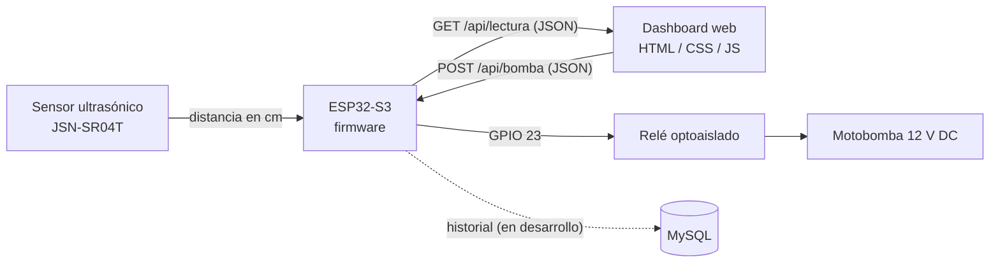

# 💧 AquaSense - Sistema IoT de Monitoreo y Control de Agua


Sistema **IoT + Web + Base de Datos** para monitorear en tiempo real el nivel de un depósito de agua y controlar su bomba de llenado. Construido con un **ESP32**, un sensor ultrasónico, un relé y un **dashboard web** responsivo en HTML, CSS y JavaScript. Proyecto del equipo **NexTech** para la **1ª Expo Feria de Proyectos ISIC 2026**.

## 📋 Descripción General

En casas y edificios, el agua de cisternas y tinacos se desperdicia porque nadie se da cuenta a tiempo de que el depósito se está desbordando o quedando vacío. AquaSense resuelve eso midiendo el nivel del agua de forma continua, clasificando su estado (Normal, Bajo o Crítico) y controlando la bomba automática o manualmente desde una página web.

El proyecto se compone de cuatro partes que trabajan juntas:

- **Prototipo físico**: lee el nivel del agua y acciona la bomba.
- **Base de datos**: guarda el historial de lecturas.
- **Dashboard web**: es la interfaz de monitoreo y control.
- **Material audiovisual**: presenta el proyecto en la exposición.

## 🏗️ Arquitectura

El sistema separa la captura de datos (hardware), la comunicación (API HTTP con JSON) y la visualización (dashboard), de modo que cada parte puede desarrollarse y probarse por separado:



- **Hardware (ESP32)**: mide la distancia al agua con el sensor ultrasónico, la convierte en porcentaje de llenado y enciende o apaga la bomba a través de un relé optoaislado.
- **API HTTP**: el ESP32 expone dos rutas en JSON, una para leer el estado y otra para recibir órdenes. Es el único punto de contacto entre el hardware y la web.
- **Dashboard web**: consulta la API cada 3 segundos, muestra el nivel, el estado y el historial, y envía las órdenes de la bomba. Está dividido en componentes independientes (un archivo por cada parte de la pantalla) y no contiene lógica de hardware.
- **Persistencia (MySQL)**: almacenará cada lectura con fecha y hora para consultar el historial a largo plazo. *(En integración.)*

## 🛠️ Tecnologías Utilizadas

- HTML5, CSS3 y JavaScript (ES6+) con módulos nativos (`import` / `export`), sin frameworks ni compilación
- SVG para la gráfica del historial y los iconos
- Google Fonts: Plus Jakarta Sans y JetBrains Mono
- ESP32-S3 (firmware del prototipo)
- Sensor ultrasónico JSN-SR04T (resistente al agua)
- MySQL (base de datos del historial)
- Git y GitHub (control de versiones y trabajo en equipo)

## ✨ Funcionalidades

- **Nivel en tiempo real:** el porcentaje del depósito se muestra en un tanque animado y en una barra de progreso, con litros y distancia del sensor.
- **Estados con código de color:** 🟢 Normal, 🟡 Bajo y 🔴 Crítico, que cambian el color de toda la interfaz.
- **Control de bomba:** un botón para encenderla o apagarla manualmente, con confirmación visual mientras se envía la orden.
- **Corte anti-desborde:** apaga la bomba automáticamente al llegar al 90 %.
- **Llenado automático opcional:** enciende la bomba cuando el nivel baja a crítico.
- **Paro de emergencia:** apaga la bomba desde el menú lateral.
- **Historial de lecturas:** una gráfica del nivel en el tiempo y una tabla con hora, nivel, volumen, estado de la bomba y estado del depósito.
- **Exportación a CSV:** descarga del historial de lecturas.
- **Registro de eventos y alertas:** cambios de estado, acciones sobre la bomba y errores de conexión.
- **Modo simulación:** permite probar y demostrar el dashboard sin el prototipo conectado.
- **Diseño responsivo:** se adapta a computadora, tablet y celular.

## 🚦 Estados del Depósito

| Estado | Rango | Significado |
|---|---|---|
| 🟢 Normal | 50 % o más | Nivel saludable de agua. |
| 🟡 Bajo | 20 % a 49 % | Conviene encender la bomba. |
| 🔴 Crítico | Menos de 20 % | Riesgo de quedarse sin agua. |

Los umbrales se configuran en `js/config.js`.

## 📁 Estructura del Proyecto

```
aquasense/
├── index.html                  # Estructura de la página
├── css/
│   ├── base.css                # Colores, tipografía, tarjetas, chips y botones
│   └── components.css          # Estilos de cada parte del dashboard
├── js/
│   ├── main.js                 # Arranque, ciclo de lectura y automatización
│   ├── config.js               # IP del ESP32, umbrales y capacidad del tanque
│   ├── state.js                # Estado compartido de la app
│   ├── api.js                  # Simulación y comunicación con el ESP32
│   ├── utils.js                # Funciones de apoyo
│   └── components/
│       ├── Sidebar.js          # Menú lateral, enlace MCU y paro de emergencia
│       ├── Topbar.js           # Barra superior y franja de estado
│       ├── TankCard.js         # Tanque animado y barra de nivel
│       ├── PumpControl.js      # Control de la bomba y automatización
│       ├── HistoryPanel.js     # Gráfica, tabla y exportación a CSV
│       └── EventLog.js         # Registro de eventos y alertas
└── README.md
```

El dashboard sigue una organización por componentes, parecida a la de React pero con JavaScript puro:

- **`state.js`:** guarda los datos que comparten todos los componentes.
- **Cada componente:** exporta una función `init` que conecta sus botones y una función `render` que dibuja su parte de la pantalla.
- **`main.js`:** pide una lectura nueva cada 3 segundos, actualiza el estado y llama a los `render`.

Así cada integrante puede trabajar en su componente sin interferir con los demás.

Conforme se integren las demás partes del proyecto, se organizarán en carpetas (`dashboard/`, `firmware/`, `database/`, `docs/`).

## 🚀 Cómo Ejecutarlo

No requiere instalar dependencias. Clona o descarga el repositorio y ábrelo con **Visual Studio Code** y la extensión **Live Server**: clic derecho sobre `index.html` y luego *Open with Live Server*. La página se recarga sola al guardar cambios.

> **Importante:** como el dashboard usa módulos de JavaScript, **no funciona abriendo `index.html` con doble clic**. Por seguridad, el navegador bloquea los `import` entre archivos locales, así que siempre debe abrirse desde un servidor como Live Server o GitHub Pages.

Por defecto el dashboard corre en **modo simulación**, que genera lecturas de prueba. Para conectarlo al prototipo real, edita `js/config.js` y cambia `API_BASE` de `null` a la IP del ESP32, por ejemplo `'http://192.168.1.50'`. La computadora y el ESP32 deben estar en la misma red WiFi.

## 🔌 API del ESP32

Toda la comunicación con el hardware vive en `js/api.js`.

| Ruta | Método | Descripción | Ejemplo |
|---|---|---|---|
| `/api/lectura` | GET | Devuelve el nivel del depósito (0–100) y el estado de la bomba. | `{"nivel": 76.1, "bomba": 0}` |
| `/api/bomba` | POST | Recibe la orden de encender (`1`) o apagar (`0`) la bomba. | `{"estado": 1}` |

Si el dashboard no se sirve desde el propio ESP32, el firmware debe responder con la cabecera `Access-Control-Allow-Origin: *` para que el navegador permita las peticiones (CORS).

> **Nota:** la tensión, el consumo y la potencia de la bomba que muestra el dashboard son valores simulados, ya que el prototipo no incluye sensor de corriente.

## 🔧 Hardware

| Componente | Conexión |
|---|---|
| ESP32-S3 | Microcontrolador principal |
| Sensor JSN-SR04T (TRIG) | GPIO 05 |
| Sensor JSN-SR04T (ECHO) | GPIO 18 |
| Relé optoaislado | GPIO 23 |
| Motobomba sumergible | 12 V DC, controlada por el relé |

## 🤝 Cómo Colaborar

1. **Actualiza tu copia.** Antes de empezar, haz *Pull* para traer los cambios más recientes.
2. **Trabaja en tu propia rama** si vas a modificar archivos que también edita otro integrante.
3. **Escribe commits descriptivos**, por ejemplo *"Agrega gráfica por horas al historial"*.
4. **Abre un Pull Request** hacia `main` y pide que alguien del equipo lo revise antes de mezclarlo.

## 👥 Equipo NexTech

| Integrante | Rol |
|---|---|
| Ari Gael Núñez Sánchez | |
| Yeri Zoé Núñez Sánchez | |
| José Manuel Martínez Morales | |
| Jorge Leal Cuevas | Dashboard web y material audiovisual |
| Alexander Angeles Santiago | |

---

*Ingeniería en Sistemas Computacionales · Tecnológico de Estudios Superiores de Jilotepec · 1ª Expo Feria de Proyectos ISIC 2026*
